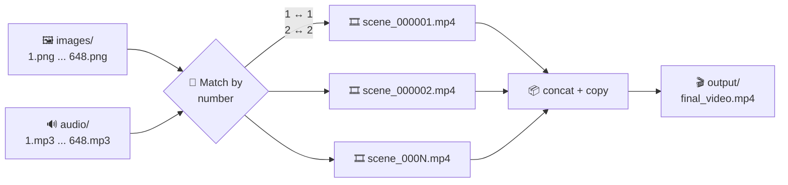
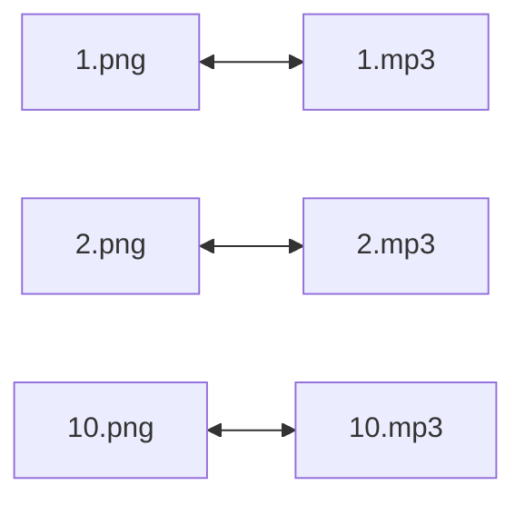
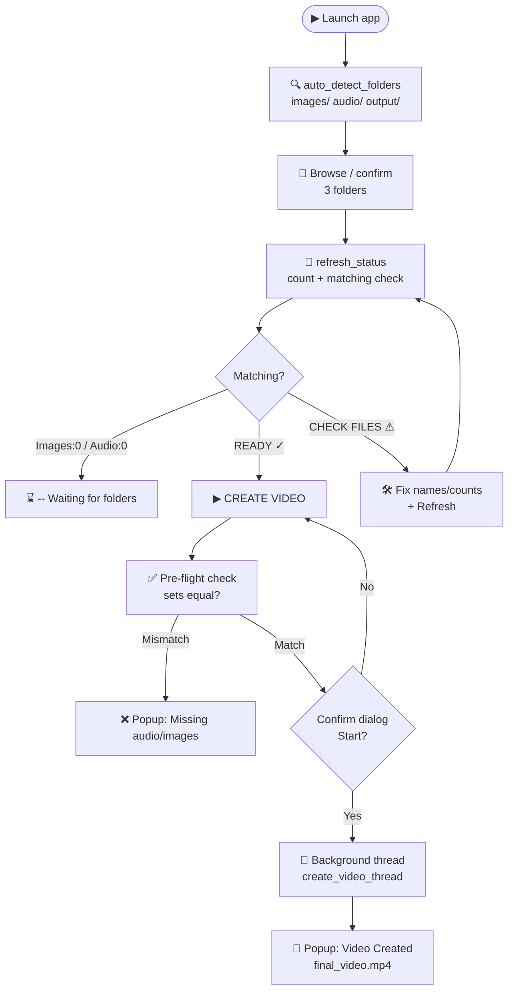
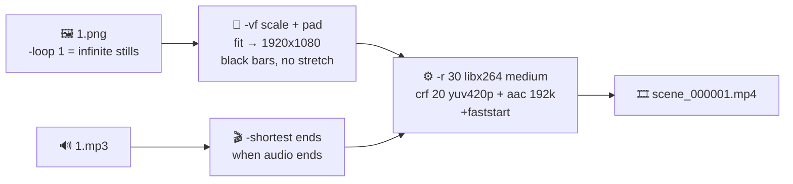
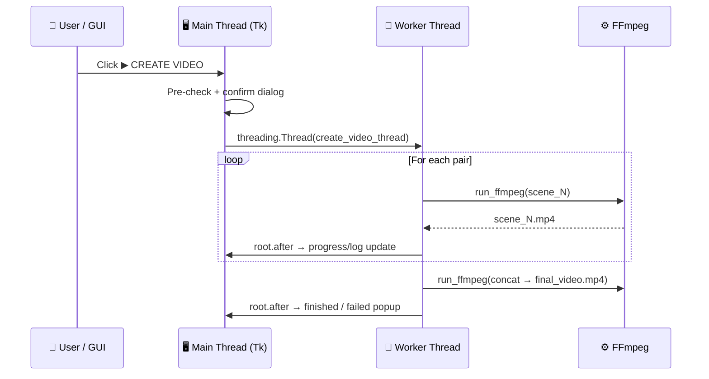

# 🎬 Image + Audio to Single Video Maker

`images_audio_to_single_video.py` is a Windows desktop app (Tkinter GUI + FFmpeg) that automatically matches **numbered images** with **numbered audio files** and combines them into **one single MP4 video**.

Each `image + audio` pair becomes one scene (slideshow-style clip where the image duration = audio duration), and then all scenes are concatenated losslessly into `final_video.mp4`.

Example: `images/1.png` + `audio/1.mp3` → Scene 1, `images/2.png` + `audio/2.mp3` → Scene 2, ... → `output/final_video.mp4`

## 🗺️ Overview Diagram



---

## ✨ Features

- 🖼️ + 🔊 **Auto-pairing by number** — extracts the first number from each filename and pairs `1 ↔ 1`, `2 ↔ 2`, etc.
- 🎥 **Full HD output** — 1920×1080, 30 FPS, H.264 + AAC, `yuv420p` (YouTube / player compatible)
- 🖥️ **Easy Tkinter GUI** with folder pickers, live status, progress bar, and activity log
- 🔍 **Auto-detect folders** — finds `images/`, `audio/`, `output/` next to the script on startup
- ✅ **Pre-flight validation** — checks for missing pairs, duplicate numbers, and missing FFmpeg before encoding
- 🧵 **Non-blocking UI** — encoding runs in a background thread
- 📦 **Safe concat** — each scene is encoded independently, then joined with `ffmpeg -c copy` (fast, no re-encode)
- 🧹 **Automatic cleanup** — temporary scene files are deleted after finishing
- ⚠️ **Clear error messages** — e.g. `Images without audio: 5, 6` / `Audio without images: 7`

---

## 📋 Requirements

1. **Python 3.8+** (Tkinter is included with standard Windows Python)
   - No third-party Python packages needed — only standard library: `os`, `re`, `shutil`, `subprocess`, `tempfile`, `threading`, `tkinter`, `pathlib`

2. **FFmpeg installed and on PATH**
   - Download from: https://ffmpeg.org/download.html (Windows builds via `gyan.dev` or `BtbN`)
   - Verify in PowerShell / CMD:
     ```bat
     ffmpeg -version
     ```
   - If you get `not recognized`, add FFmpeg's `bin` folder to Windows PATH:
     `System Properties → Environment Variables → Path → Edit → New → C:\ffmpeg\bin`
   - The app checks this on startup of a job and shows an error if FFmpeg is missing.

---

## 📁 Project Structure

```text
video_maker/
├── images_audio_to_single_video.py  # ← main app (this README)
├── images/                          # input images: 1.png, 2.png, ... 648.png
├── audio/                           # input audio:  1.mp3, 2.mp3, ... 648.mp3
├── audio1/                          # (extra / unused in this script)
├── output/                          # created if needed, contains final_video.mp4
└── video/                           # (extra / unused in this script)
```

> The GUI auto-detects `images/`, `audio/`, and `output/` in the same folder as the `.py` file. You can also click **Browse** to pick any folders.

---

## 🏷️ File Naming Rules (Important!)

Pairing is done by the **first number found in the filename** (`re.search(r"\d+", path.stem)`).

Correct:

```text
images/1.png, images/2.png, ..., images/10.png
audio/1.mp3,  audio/2.mp3,  ..., audio/10.mp3
```

Also works with descriptive names as long as numbers match:

```text
images/scene_001.png  ↔  audio/scene_001.mp3
images/image-12.jpg   ↔  audio/narration-12.wav
```

Rules:

- Every image number **must have exactly one** matching audio number, and vice versa. Otherwise the app aborts with a list of mismatches.
- Duplicate numbers (e.g. `1.png` and `1.jpg` in the same folder) raise an error: `Duplicate number 1 found`. Keep only one file per number.
- Files **without any number** are ignored (e.g. `thumbnail.png`, `intro.mp3`).
- Sorting is **numeric**, not alphabetical — `2` comes before `10`.
- Subfolders are **not** scanned — only files directly inside the selected folder.

Supported extensions:

| Type  | Extensions |
|-------|------------|
| Image | `.png`, `.jpg`, `.jpeg`, `.webp`, `.bmp` |
| Audio | `.mp3`, `.wav`, `.m4a`, `.aac`, `.flac`, `.ogg` |

### 🔗 Number-Matching Flow

```mermaid
flowchart TD
    A[📂 Scan folder files] --> B{Has valid\nextension?}
    B -- No --> X1[⏭️ Skip]
    B -- Yes --> C[🔢 get_number:\nfirst \d+ in stem]
    C --> D{Number found?}
    D -- No --> X2[⏭️ Ignore\n e.g. thumbnail.png]
    D -- Yes --> E{Number already\nseen?}
    E -- Yes --> ERR[❌ Duplicate number error]
    E -- No --> F[✅ files[number] = path]
```



> Numeric sort is used, so play order is `1 → 2 → 10`, not `1 → 10 → 2`.

---

## 🚀 Usage (GUI)

1. Run the app:

   ```bat
   python images_audio_to_single_video.py
   ```

2. In the window **🎬 Image + Audio Video Maker**:
   - **🖼 Images** → select your images folder (auto-filled if `images/` exists)
   - **🔊 Audio** → select your audio folder (auto-filled if `audio/` exists)
   - **📁 Output** → select where `final_video.mp4` will be saved

3. Check **Project Status**:
   - `🖼 Images: N` / `🔊 Audio: M` — file counts detected
   - `✓ Matching: READY` — counts equal (still verifies exact numbers on start)
   - `⚠ Matching: CHECK FILES` — counts differ, fix before running

4. Click **▶ CREATE VIDEO** → confirm the dialog (`Images: N, Audio: N, 1920×1080, 30 FPS`) → watch the **Progress bar** and **Activity Log** (e.g. `[3/648] Creating scene 3`).

5. On success you get a popup:

   ```text
   Video created successfully!

   Scenes: 648

   Saved to:
   C:\...\video_maker\output\final_video.mp4
   ```

   Output file is always `<output_folder>/final_video.mp4` (overwritten with `-y` if it exists).

6. Use **🔄 Refresh** any time to rescan the folders after adding/removing files.

### 🖱️ GUI User Flow



---

## 🧠 How It Works (Pipeline)

### 🔄 End-to-End Encoding Pipeline

```mermaid
flowchart TD
    S([▶ make_video called]) --> FF{check_ffmpeg?\nffmpeg -version}
    FF -- Not found --> E0[❌ Raise: Install FFmpeg]
    FF -- OK --> SCAN1[🔍 collect_files images]
    SCAN1 --> SCAN2[🔍 collect_files audio]
    SCAN2 --> EMPTY{Empty?}
    EMPTY -- Yes --> E1[❌ No numbered files]
    EMPTY -- No --> MATCH{image_numbers ==\naudio_numbers?}
    MATCH -- No --> E2[❌ Images without audio /\nAudio without images]
    MATCH -- Yes --> TMP[📂 mkdtemp video_maker_]
    TMP --> LOOP[🔁 For each number sorted]
    LOOP --> ENC[🎞️ ffmpeg -loop 1 + -shortest\nscale/pad → 1920x1080\nlibx264 + aac]
    ENC --> PROG[📊 progress 0→90%\nlog [i/N] Creating scene]
    PROG --> MORE{More scenes?}
    MORE -- Yes --> LOOP
    MORE -- No --> CONC[📝 Write concat.txt]
    CONC --> JOIN[📦 ffmpeg -f concat -c copy\n→ final_video.mp4]
    JOIN --> P100[📊 progress 100%]
    P100 --> CLN[🧹 rmtree temp_dir]
    CLN --> OK([✅ Return output_file, count])
    E0 & E1 & E2 --> CLN
```

### 🎞️ Single-Scene Detail



### 🧵 Threading Model



`make_video(images_folder, audio_folder, output_folder, progress_callback, log_callback)`:

1. **Check FFmpeg** — runs `ffmpeg -version`.
2. **Scan folders** — `collect_files()` builds `{number: Path}` dicts for images and audio.
3. **Match pairs** — compares number sets; raises `RuntimeError` listing `Images without audio` / `Audio without images`.
4. **Create temp dir** — `tempfile.mkdtemp(prefix="video_maker_")`.
5. **Build one scene per pair** (sorted numerically) with FFmpeg:

   ```bat
   ffmpeg -y -loop 1 -i <image> -i <audio> ^
     -vf "scale=1920:1080:force_original_aspect_ratio=decrease,pad=1920:1080:(ow-iw)/2:(oh-ih)/2" ^
     -r 30 -c:v libx264 -preset medium -crf 20 -pix_fmt yuv420p ^
     -c:a aac -b:a 192k -shortest -movflags +faststart ^
     scene_000001.mp4
   ```

   - `-loop 1` + `-shortest` → video duration = audio duration
   - `scale` + `pad` → fits any aspect ratio into 1920×1080 with black bars (no stretching)
   - Progress goes 0 → 90% across scenes.

6. **Concatenate** — writes `concat.txt` (`file '...scene_xxx.mp4'`) then:

   ```bat
   ffmpeg -y -f concat -safe 0 -i concat.txt -c copy -movflags +faststart final_video.mp4
   ```

7. **Cleanup** — `shutil.rmtree(temp_dir)` in a `finally` block, even on failure.

---

## 🎞️ Output Specification

| Property   | Value |
|------------|-------|
| File       | `final_video.mp4` in chosen output folder |
| Resolution | 1920 × 1080 (Full HD, padded) |
| FPS        | 30 |
| Video codec| H.264 (`libx264`, `-preset medium`, `-crf 20`, `yuv420p`) |
| Audio codec| AAC, 192k |
| Flags      | `+faststart` (fast web / streaming start) |
| Scene length | = length of its paired audio file |

To change quality/speed, edit the constants at the top of the script:

```python
VIDEO_WIDTH = 1920
VIDEO_HEIGHT = 1080
FPS = 30
```

e.g. `-crf 20` → `18` (higher quality, bigger file), `-preset medium` → `fast` / `veryfast` (faster encode, bigger file).

---

## 🐍 Programmatic / No-GUI Usage

You can import the core function in your own script:

```python
from images_audio_to_single_video import make_video

output_file, count = make_video(
    images_folder="images",
    audio_folder="audio",
    output_folder="output",
    progress_callback=lambda v: print(f"{v}%"),
    log_callback=print,
)
print(f"Done: {output_file} ({count} scenes)")
```

Helper functions available:

- `check_ffmpeg() -> bool`
- `get_number(path: Path) -> int | None`
- `collect_files(folder, extensions) -> dict[int, Path]`
- `run_ffmpeg(command: list[str])` — raises `RuntimeError` with last 5000 chars of stderr
- `make_video(...) -> tuple[Path, int]`

---

## ❓ Troubleshooting

| Problem | Cause / Fix |
|---------|-------------|
| `FFmpeg was not found` | Install FFmpeg and add `bin` to PATH, restart terminal, verify `ffmpeg -version`. |
| `No numbered images / audio found` | Folder path wrong, wrong extension, or filenames contain no digits. Check `refresh_status` counts. |
| `Images without audio: 5, 6` | Add `5.mp3`, `6.mp3` or remove `5.png`, `6.png` so sets match exactly. |
| `Duplicate number 3 found` | Two files map to `3` (e.g. `3.png` + `3.jpg`). Delete/rename one. |
| `matching: CHECK FILES` stays | Counts differ — click Refresh after fixing; also watch for duplicate-number errors. |
| Encode fails mid-run | See Activity Log popup / stderr tail; common causes: corrupt image/audio, unreadable characters in path, no disk space, missing `libx264`/`aac` in FFmpeg build. |
| Output is huge / slow | 648 scenes at `medium`/`crf 20` takes a while. Use `-preset fast` or `-crf 23` for speed/size tradeoff. |
| Black bars on video | Expected — non-16:9 images are letterboxed/pillarboxed to 1920×1080 to avoid stretching. |
| App window frozen | Encoding runs in a thread; progress/log update via `root.after`. Don't close the window mid-encode — wait for success/error dialog. |

---

## ⚠️ Notes & Limitations

- Output filename is fixed (`final_video.mp4`) and overwritten without prompt by FFmpeg `-y` (GUI asks for confirmation once before starting).
- Only the first number in a filename is used — `part1_take2.png` pairs as `1`, not `1-2`.
- Large jobs (e.g. 648 pairs in this repo) create 648 temp MP4s — ensure enough free disk space (temp dir is system temp, output is final destination).
- Windows-only `CREATE_NO_WINDOW` flag is guarded by `os.name == "nt"`, so the script also runs on Linux/macOS if FFmpeg is installed.
- GUI dialogs and labels use Windows `vista` theme + `Segoe UI`; falls back gracefully on other OSes.

---

## 📜 License

No license file included. Add one if you plan to distribute (e.g. MIT).
